# Experiment report: `main`

Generated by `scripts/generate_report.py` from `results/raw/main/`. Mean ± std over seeds [42, 123, 2026]; test split of 86 patients per seed (54 benign / 32 malignant). Malignant = positive class.

Config: rounds=50, local_epochs=1, batch=16, lr=0.05, optimizer=SGD, MLP 30-64-32-2, FedHAW tuned (lr_gamma=1e-05, lr_lambda=0.01), FedHAW repo defaults (1e-3, 1e-2), FedProx mu_prox=0.01.

## IID

| Method | Accuracy | Recall | Specificity | FPR | Precision | F1 | ROC-AUC |
|---|---|---|---|---|---|---|---|
| Centralized | 0.9651 ± 0.0164 | 0.9583 ± 0.0147 | 0.9691 ± 0.0231 | 0.0309 ± 0.0231 | 0.9498 ± 0.0370 | 0.9537 ± 0.0215 | 0.9846 ± 0.0086 |
| FedAvg | 0.9729 ± 0.0198 | 0.9792 ± 0.0147 | 0.9691 ± 0.0231 | 0.0309 ± 0.0231 | 0.9504 ± 0.0369 | 0.9644 ± 0.0258 | 0.9942 ± 0.0063 |
| FedProx | 0.9729 ± 0.0198 | 0.9792 ± 0.0147 | 0.9691 ± 0.0231 | 0.0309 ± 0.0231 | 0.9504 ± 0.0369 | 0.9644 ± 0.0258 | 0.9942 ± 0.0063 |
| FedHAW (repo defaults) | 0.9651 ± 0.0164 | 0.9583 ± 0.0147 | 0.9691 ± 0.0231 | 0.0309 ± 0.0231 | 0.9498 ± 0.0370 | 0.9537 ± 0.0215 | 0.9841 ± 0.0058 |
| FedHAW (val-tuned) | 0.9729 ± 0.0198 | 0.9792 ± 0.0147 | 0.9691 ± 0.0231 | 0.0309 ± 0.0231 | 0.9504 ± 0.0369 | 0.9644 ± 0.0258 | 0.9942 ± 0.0063 |

Per-hospital (held-out hospital test subsets):

| Method | Mean hospital acc. | Mean hospital recall | Worst hospital recall | Std hospital recall | Best–worst recall gap |
|---|---|---|---|---|---|
| Centralized | 0.9654 ± 0.0166 | 0.9587 ± 0.0147 | 0.8413 ± 0.0112 | 0.0667 ± 0.0078 | 0.1587 ± 0.0112 |
| FedAvg | 0.9728 ± 0.0198 | 0.9794 ± 0.0147 | 0.8968 ± 0.0736 | 0.0413 ± 0.0294 | 0.1032 ± 0.0736 |
| FedProx | 0.9728 ± 0.0198 | 0.9794 ± 0.0147 | 0.8968 ± 0.0736 | 0.0413 ± 0.0294 | 0.1032 ± 0.0736 |
| FedHAW (repo defaults) | 0.9654 ± 0.0166 | 0.9587 ± 0.0147 | 0.8413 ± 0.0112 | 0.0667 ± 0.0078 | 0.1587 ± 0.0112 |
| FedHAW (val-tuned) | 0.9728 ± 0.0198 | 0.9794 ± 0.0147 | 0.8968 ± 0.0736 | 0.0413 ± 0.0294 | 0.1032 ± 0.0736 |

## Dirichlet α=10

| Method | Accuracy | Recall | Specificity | FPR | Precision | F1 | ROC-AUC |
|---|---|---|---|---|---|---|---|
| Centralized | 0.9651 ± 0.0164 | 0.9583 ± 0.0147 | 0.9691 ± 0.0231 | 0.0309 ± 0.0231 | 0.9498 ± 0.0370 | 0.9537 ± 0.0215 | 0.9846 ± 0.0086 |
| FedAvg | 0.9767 ± 0.0095 | 0.9688 ± 0.0000 | 0.9815 ± 0.0151 | 0.0185 ± 0.0151 | 0.9694 ± 0.0247 | 0.9689 ± 0.0124 | 0.9940 ± 0.0060 |
| FedProx | 0.9767 ± 0.0095 | 0.9688 ± 0.0000 | 0.9815 ± 0.0151 | 0.0185 ± 0.0151 | 0.9694 ± 0.0247 | 0.9689 ± 0.0124 | 0.9940 ± 0.0060 |
| FedHAW (repo defaults) | 0.9612 ± 0.0198 | 0.9583 ± 0.0147 | 0.9630 ± 0.0262 | 0.0370 ± 0.0262 | 0.9403 ± 0.0422 | 0.9489 ± 0.0258 | 0.9843 ± 0.0062 |
| FedHAW (val-tuned) | 0.9767 ± 0.0095 | 0.9688 ± 0.0000 | 0.9815 ± 0.0151 | 0.0185 ± 0.0151 | 0.9694 ± 0.0247 | 0.9689 ± 0.0124 | 0.9940 ± 0.0060 |

Per-hospital (held-out hospital test subsets):

| Method | Mean hospital acc. | Mean hospital recall | Worst hospital recall | Std hospital recall | Best–worst recall gap |
|---|---|---|---|---|---|
| Centralized | 0.9656 ± 0.0170 | 0.9549 ± 0.0160 | 0.8302 ± 0.0234 | 0.0729 ± 0.0112 | 0.1698 ± 0.0234 |
| FedAvg | 0.9769 ± 0.0094 | 0.9660 ± 0.0047 | 0.8302 ± 0.0234 | 0.0679 ± 0.0094 | 0.1698 ± 0.0234 |
| FedProx | 0.9769 ± 0.0094 | 0.9660 ± 0.0047 | 0.8302 ± 0.0234 | 0.0679 ± 0.0094 | 0.1698 ± 0.0234 |
| FedHAW (repo defaults) | 0.9600 ± 0.0214 | 0.9549 ± 0.0160 | 0.8302 ± 0.0234 | 0.0729 ± 0.0112 | 0.1698 ± 0.0234 |
| FedHAW (val-tuned) | 0.9769 ± 0.0094 | 0.9660 ± 0.0047 | 0.8302 ± 0.0234 | 0.0679 ± 0.0094 | 0.1698 ± 0.0234 |

## Dirichlet α=1

| Method | Accuracy | Recall | Specificity | FPR | Precision | F1 | ROC-AUC |
|---|---|---|---|---|---|---|---|
| Centralized | 0.9651 ± 0.0164 | 0.9583 ± 0.0147 | 0.9691 ± 0.0231 | 0.0309 ± 0.0231 | 0.9498 ± 0.0370 | 0.9537 ± 0.0215 | 0.9846 ± 0.0086 |
| FedAvg | 0.9729 ± 0.0110 | 0.9688 ± 0.0000 | 0.9753 ± 0.0175 | 0.0247 ± 0.0175 | 0.9596 ± 0.0286 | 0.9639 ± 0.0143 | 0.9940 ± 0.0060 |
| FedProx | 0.9729 ± 0.0110 | 0.9688 ± 0.0000 | 0.9753 ± 0.0175 | 0.0247 ± 0.0175 | 0.9596 ± 0.0286 | 0.9639 ± 0.0143 | 0.9940 ± 0.0060 |
| FedHAW (repo defaults) | 0.9535 ± 0.0251 | 0.9583 ± 0.0147 | 0.9506 ± 0.0381 | 0.0494 ± 0.0381 | 0.9234 ± 0.0576 | 0.9397 ± 0.0318 | 0.9796 ± 0.0089 |
| FedHAW (val-tuned) | 0.9729 ± 0.0110 | 0.9688 ± 0.0000 | 0.9753 ± 0.0175 | 0.0247 ± 0.0175 | 0.9596 ± 0.0286 | 0.9639 ± 0.0143 | 0.9940 ± 0.0060 |

Per-hospital (held-out hospital test subsets):

| Method | Mean hospital acc. | Mean hospital recall | Worst hospital recall | Std hospital recall | Best–worst recall gap |
|---|---|---|---|---|---|
| Centralized | 0.9692 ± 0.0158 | 0.9602 ± 0.0236 | 0.8296 ± 0.0927 | 0.0720 ± 0.0403 | 0.1704 ± 0.0927 |
| FedAvg | 0.9752 ± 0.0122 | 0.9721 ± 0.0094 | 0.8772 ± 0.0463 | 0.0513 ± 0.0184 | 0.1228 ± 0.0463 |
| FedProx | 0.9752 ± 0.0122 | 0.9721 ± 0.0094 | 0.8772 ± 0.0463 | 0.0513 ± 0.0184 | 0.1228 ± 0.0463 |
| FedHAW (repo defaults) | 0.9565 ± 0.0259 | 0.9602 ± 0.0236 | 0.8296 ± 0.0927 | 0.0720 ± 0.0403 | 0.1704 ± 0.0927 |
| FedHAW (val-tuned) | 0.9752 ± 0.0122 | 0.9721 ± 0.0094 | 0.8772 ± 0.0463 | 0.0513 ± 0.0184 | 0.1228 ± 0.0463 |

## Dirichlet α=0.1

| Method | Accuracy | Recall | Specificity | FPR | Precision | F1 | ROC-AUC |
|---|---|---|---|---|---|---|---|
| Centralized | 0.9651 ± 0.0164 | 0.9583 ± 0.0147 | 0.9691 ± 0.0231 | 0.0309 ± 0.0231 | 0.9498 ± 0.0370 | 0.9537 ± 0.0215 | 0.9846 ± 0.0086 |
| FedAvg | 0.9729 ± 0.0110 | 0.9479 ± 0.0295 | 0.9877 ± 0.0175 | 0.0123 ± 0.0175 | 0.9798 ± 0.0286 | 0.9629 ± 0.0150 | 0.9925 ± 0.0046 |
| FedProx | 0.9729 ± 0.0110 | 0.9479 ± 0.0295 | 0.9877 ± 0.0175 | 0.0123 ± 0.0175 | 0.9798 ± 0.0286 | 0.9629 ± 0.0150 | 0.9927 ± 0.0047 |
| FedHAW (repo defaults) | 0.9612 ± 0.0110 | 0.9583 ± 0.0147 | 0.9630 ± 0.0151 | 0.0370 ± 0.0151 | 0.9393 ± 0.0233 | 0.9485 ± 0.0143 | 0.9770 ± 0.0108 |
| FedHAW (val-tuned) | 0.9729 ± 0.0110 | 0.9479 ± 0.0295 | 0.9877 ± 0.0175 | 0.0123 ± 0.0175 | 0.9798 ± 0.0286 | 0.9629 ± 0.0150 | 0.9923 ± 0.0045 |

Per-hospital (held-out hospital test subsets):

| Method | Mean hospital acc. | Mean hospital recall | Worst hospital recall | Std hospital recall | Best–worst recall gap |
|---|---|---|---|---|---|
| Centralized | 0.9022 ± 0.0850 | 0.8479 ± 0.1344 | 0.5437 ± 0.4032 | 0.2151 ± 0.1901 | 0.4563 ± 0.4032 |
| FedAvg | 0.9010 ± 0.0827 | 0.8368 ± 0.1319 | 0.5437 ± 0.4032 | 0.2093 ± 0.1920 | 0.4563 ± 0.4032 |
| FedProx | 0.9010 ± 0.0827 | 0.8368 ± 0.1319 | 0.5437 ± 0.4032 | 0.2093 ± 0.1920 | 0.4563 ± 0.4032 |
| FedHAW (repo defaults) | 0.9005 ± 0.0833 | 0.8479 ± 0.1344 | 0.5437 ± 0.4032 | 0.2151 ± 0.1901 | 0.4563 ± 0.4032 |
| FedHAW (val-tuned) | 0.9010 ± 0.0827 | 0.8368 ± 0.1319 | 0.5437 ± 0.4032 | 0.2093 ± 0.1920 | 0.4563 ± 0.4032 |

## Figures

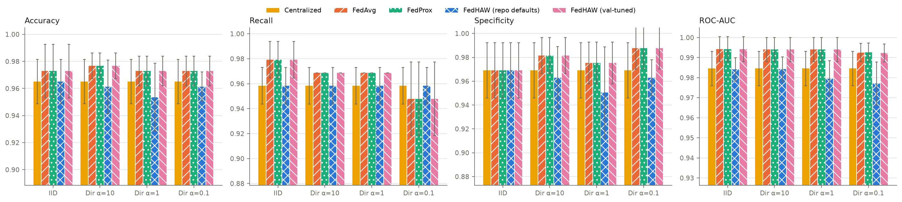
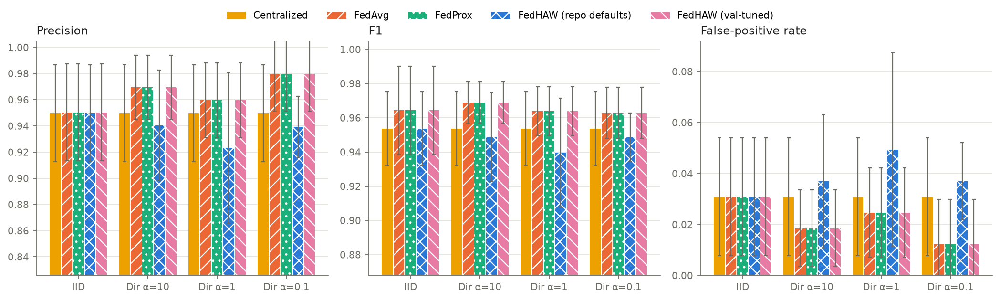
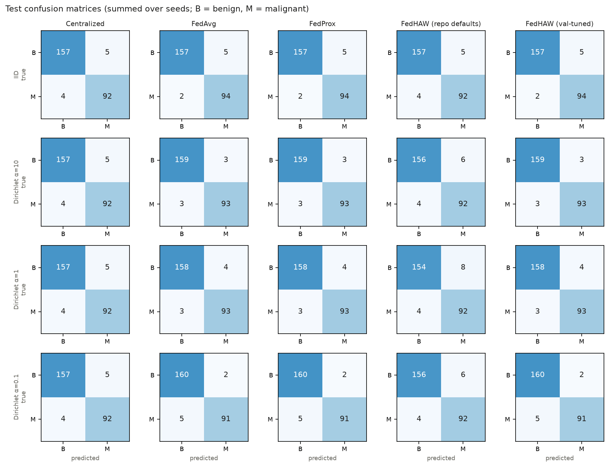
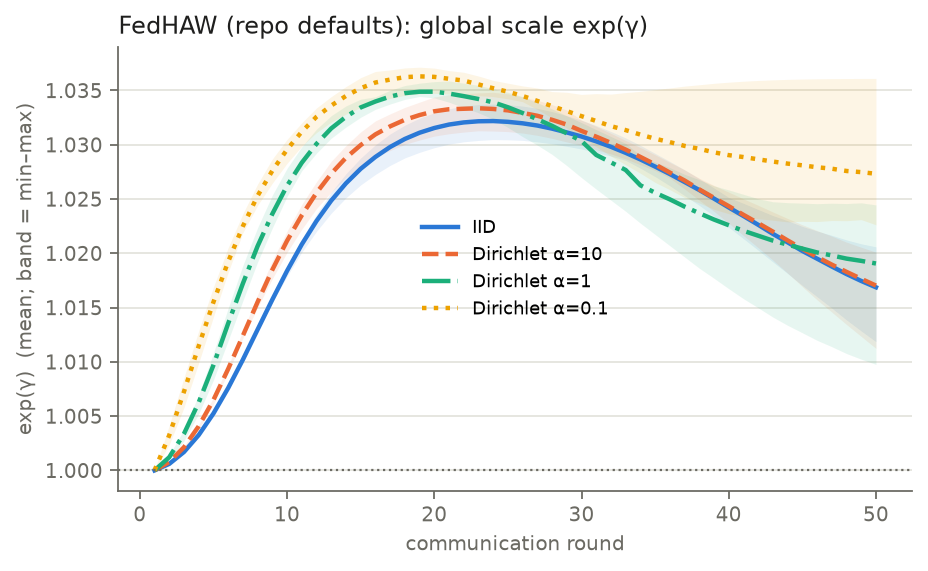
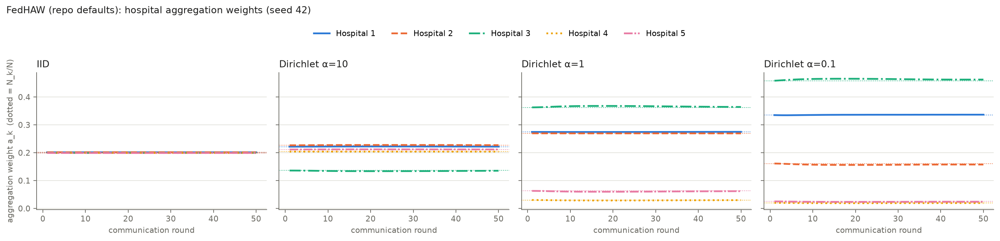
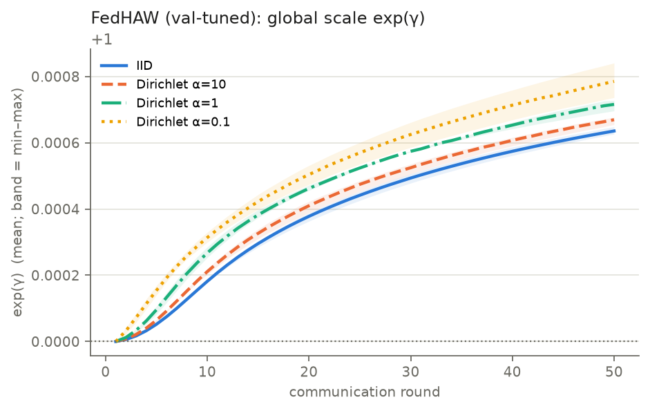
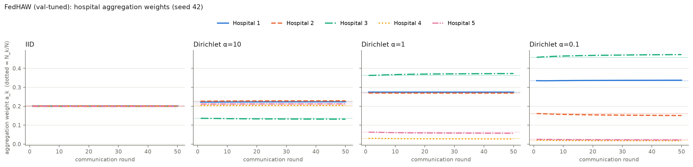
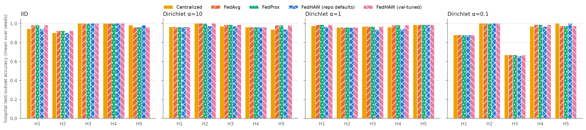
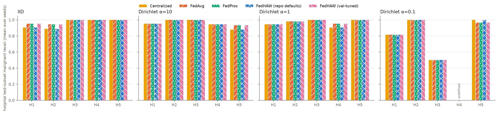
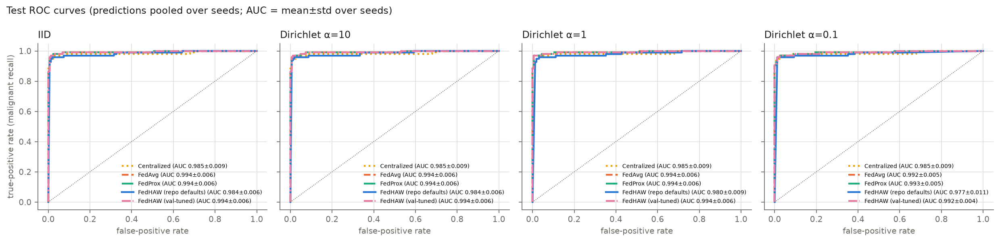
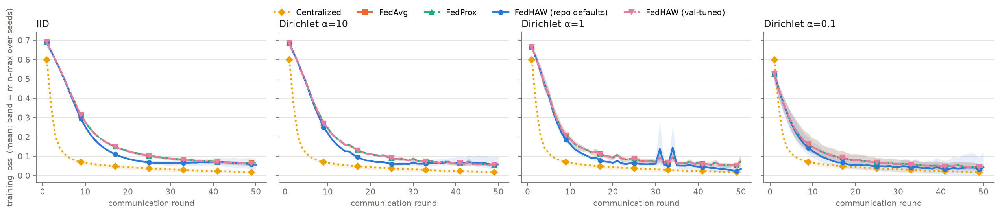
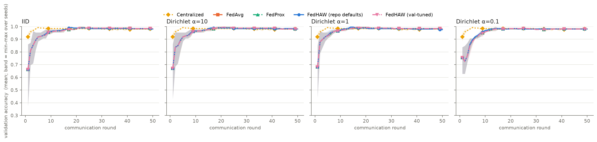
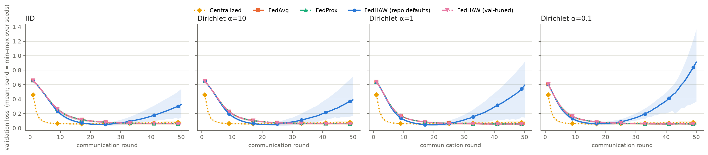
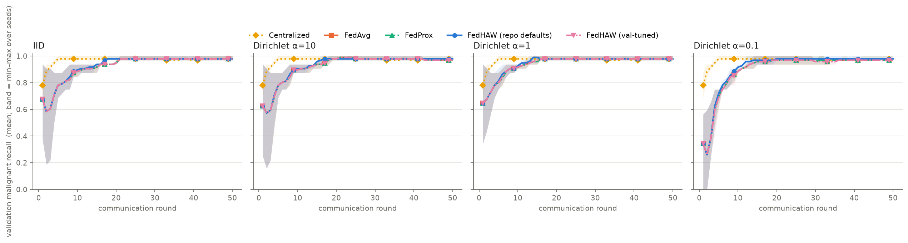
