# Experiment report: `suggested_lr0.001`

Generated by `scripts/generate_report.py` from `results/raw/suggested_lr0.001/`. Mean ± std over seeds [42, 123, 2026]; test split of 86 patients per seed (54 benign / 32 malignant). Malignant = positive class.

Config: rounds=50, local_epochs=1, batch=16, lr=0.001, optimizer=SGD, MLP 30-64-32-2, FedHAW tuned (lr_gamma=1e-05, lr_lambda=0.01), FedHAW repo defaults (1e-3, 1e-2), FedProx mu_prox=0.01.

## IID

| Method | Accuracy | Recall | Specificity | FPR | Precision | F1 | ROC-AUC |
|---|---|---|---|---|---|---|---|
| Centralized | 0.9147 ± 0.0305 | 0.7708 ± 0.0820 | 1.0000 ± 0.0000 | 0.0000 ± 0.0000 | 1.0000 ± 0.0000 | 0.8681 ± 0.0540 | 0.9869 ± 0.0086 |
| FedAvg | 0.6550 ± 0.1705 | 0.6979 ± 0.2425 | 0.6296 ± 0.3931 | 0.3704 ± 0.3931 | 0.6469 ± 0.1817 | 0.6084 ± 0.0892 | 0.8528 ± 0.0416 |
| FedProx | 0.6550 ± 0.1705 | 0.6979 ± 0.2425 | 0.6296 ± 0.3931 | 0.3704 ± 0.3931 | 0.6469 ± 0.1817 | 0.6084 ± 0.0892 | 0.8528 ± 0.0416 |
| FedHAW (repo defaults) | 0.6705 ± 0.1651 | 0.7604 ± 0.2371 | 0.6173 ± 0.3608 | 0.3827 ± 0.3608 | 0.6358 ± 0.1679 | 0.6380 ± 0.1024 | 0.8449 ± 0.0648 |

Per-hospital (held-out hospital test subsets):

| Method | Mean hospital acc. | Mean hospital recall | Worst hospital recall | Std hospital recall | Best–worst recall gap |
|---|---|---|---|---|---|
| Centralized | 0.9150 ± 0.0304 | 0.7730 ± 0.0857 | 0.5238 ± 0.1402 | 0.1545 ± 0.0358 | 0.4286 ± 0.0778 |
| FedAvg | 0.6551 ± 0.1707 | 0.7000 ± 0.2412 | 0.5556 ± 0.3425 | 0.1148 ± 0.0812 | 0.3333 ± 0.2357 |
| FedProx | 0.6551 ± 0.1707 | 0.7000 ± 0.2412 | 0.5556 ± 0.3425 | 0.1148 ± 0.0812 | 0.3333 ± 0.2357 |
| FedHAW (repo defaults) | 0.6706 ± 0.1661 | 0.7619 ± 0.2345 | 0.6508 ± 0.2918 | 0.0801 ± 0.0578 | 0.2381 ± 0.1695 |

## Dirichlet α=10

| Method | Accuracy | Recall | Specificity | FPR | Precision | F1 | ROC-AUC |
|---|---|---|---|---|---|---|---|
| Centralized | 0.9147 ± 0.0305 | 0.7708 ± 0.0820 | 1.0000 ± 0.0000 | 0.0000 ± 0.0000 | 1.0000 ± 0.0000 | 0.8681 ± 0.0540 | 0.9869 ± 0.0086 |
| FedAvg | 0.6589 ± 0.1741 | 0.6771 ± 0.2556 | 0.6481 ± 0.4060 | 0.3519 ± 0.4060 | 0.6767 ± 0.2032 | 0.6030 ± 0.0969 | 0.8767 ± 0.0227 |
| FedProx | 0.6589 ± 0.1741 | 0.6771 ± 0.2556 | 0.6481 ± 0.4060 | 0.3519 ± 0.4060 | 0.6767 ± 0.2032 | 0.6030 ± 0.0969 | 0.8767 ± 0.0227 |
| FedHAW (repo defaults) | 0.6822 ± 0.1296 | 0.6979 ± 0.3044 | 0.6728 ± 0.3230 | 0.3272 ± 0.3230 | 0.6645 ± 0.1669 | 0.5995 ± 0.1460 | 0.8742 ± 0.0422 |

Per-hospital (held-out hospital test subsets):

| Method | Mean hospital acc. | Mean hospital recall | Worst hospital recall | Std hospital recall | Best–worst recall gap |
|---|---|---|---|---|---|
| Centralized | 0.9131 ± 0.0258 | 0.7727 ± 0.0682 | 0.6111 ± 0.0786 | 0.1327 ± 0.0305 | 0.3889 ± 0.0786 |
| FedAvg | 0.6555 ± 0.1602 | 0.6719 ± 0.2539 | 0.5833 ± 0.3118 | 0.0847 ± 0.0774 | 0.2262 ± 0.2069 |
| FedProx | 0.6555 ± 0.1602 | 0.6719 ± 0.2539 | 0.5833 ± 0.3118 | 0.0847 ± 0.0774 | 0.2262 ± 0.2069 |
| FedHAW (repo defaults) | 0.6805 ± 0.1185 | 0.6995 ± 0.2967 | 0.5556 ± 0.4157 | 0.0919 ± 0.0676 | 0.2540 ± 0.1837 |

## Dirichlet α=1

| Method | Accuracy | Recall | Specificity | FPR | Precision | F1 | ROC-AUC |
|---|---|---|---|---|---|---|---|
| Centralized | 0.9147 ± 0.0305 | 0.7708 ± 0.0820 | 1.0000 ± 0.0000 | 0.0000 ± 0.0000 | 1.0000 ± 0.0000 | 0.8681 ± 0.0540 | 0.9869 ± 0.0086 |
| FedAvg | 0.6705 ± 0.1710 | 0.6771 ± 0.2452 | 0.6667 ± 0.4066 | 0.3333 ± 0.4066 | 0.7190 ± 0.2323 | 0.6153 ± 0.0700 | 0.9086 ± 0.0066 |
| FedProx | 0.6705 ± 0.1710 | 0.6771 ± 0.2452 | 0.6667 ± 0.4066 | 0.3333 ± 0.4066 | 0.7190 ± 0.2323 | 0.6153 ± 0.0700 | 0.9086 ± 0.0066 |
| FedHAW (repo defaults) | 0.7597 ± 0.0713 | 0.7292 ± 0.2619 | 0.7778 ± 0.2144 | 0.2222 ± 0.2144 | 0.7481 ± 0.1616 | 0.6763 ± 0.1097 | 0.9142 ± 0.0173 |

Per-hospital (held-out hospital test subsets):

| Method | Mean hospital acc. | Mean hospital recall | Worst hospital recall | Std hospital recall | Best–worst recall gap |
|---|---|---|---|---|---|
| Centralized | 0.9201 ± 0.0273 | 0.7792 ± 0.0829 | 0.5794 ± 0.0683 | 0.1466 ± 0.0145 | 0.3836 ± 0.0391 |
| FedAvg | 0.6692 ± 0.1818 | 0.6760 ± 0.2593 | 0.3889 ± 0.4374 | 0.1767 ± 0.1256 | 0.5000 ± 0.3600 |
| FedProx | 0.6692 ± 0.1818 | 0.6760 ± 0.2593 | 0.3889 ± 0.4374 | 0.1767 ± 0.1256 | 0.5000 ± 0.3600 |
| FedHAW (repo defaults) | 0.7696 ± 0.0821 | 0.7229 ± 0.2812 | 0.5000 ± 0.4082 | 0.1338 ± 0.0956 | 0.3519 ± 0.2498 |

## Dirichlet α=0.1

| Method | Accuracy | Recall | Specificity | FPR | Precision | F1 | ROC-AUC |
|---|---|---|---|---|---|---|---|
| Centralized | 0.9147 ± 0.0305 | 0.7708 ± 0.0820 | 1.0000 ± 0.0000 | 0.0000 ± 0.0000 | 1.0000 ± 0.0000 | 0.8681 ± 0.0540 | 0.9869 ± 0.0086 |
| FedAvg | 0.7481 ± 0.0882 | 0.3438 ± 0.2590 | 0.9877 ± 0.0175 | 0.0123 ± 0.0175 | 0.9545 ± 0.0455 | 0.4395 ± 0.3178 | 0.9261 ± 0.0137 |
| FedProx | 0.7481 ± 0.0882 | 0.3438 ± 0.2590 | 0.9877 ± 0.0175 | 0.0123 ± 0.0175 | 0.9545 ± 0.0455 | 0.4395 ± 0.3178 | 0.9261 ± 0.0137 |
| FedHAW (repo defaults) | 0.8605 ± 0.0000 | 0.6979 ± 0.0820 | 0.9568 ± 0.0486 | 0.0432 ± 0.0486 | 0.9223 ± 0.0799 | 0.7865 ± 0.0187 | 0.9462 ± 0.0130 |

Per-hospital (held-out hospital test subsets):

| Method | Mean hospital acc. | Mean hospital recall | Worst hospital recall | Std hospital recall | Best–worst recall gap |
|---|---|---|---|---|---|
| Centralized | 0.8323 ± 0.0712 | 0.6957 ± 0.1004 | 0.3333 ± 0.2357 | 0.2696 ± 0.1040 | 0.6458 ± 0.2517 |
| FedAvg | 0.6256 ± 0.1608 | 0.2726 ± 0.1932 | 0.1250 ± 0.1768 | 0.1137 ± 0.1246 | 0.2679 ± 0.2949 |
| FedProx | 0.6256 ± 0.1608 | 0.2726 ± 0.1932 | 0.1250 ± 0.1768 | 0.1137 ± 0.1246 | 0.2679 ± 0.2949 |
| FedHAW (repo defaults) | 0.7901 ± 0.0576 | 0.6334 ± 0.0995 | 0.3000 ± 0.2160 | 0.2661 ± 0.1066 | 0.6375 ± 0.2588 |

## Figures

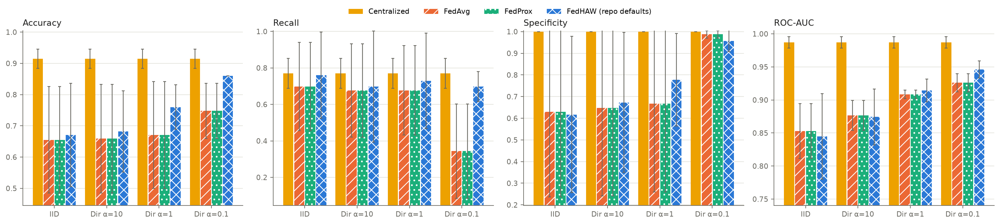
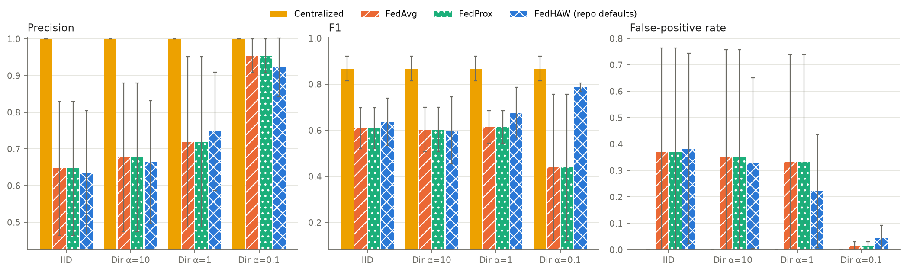
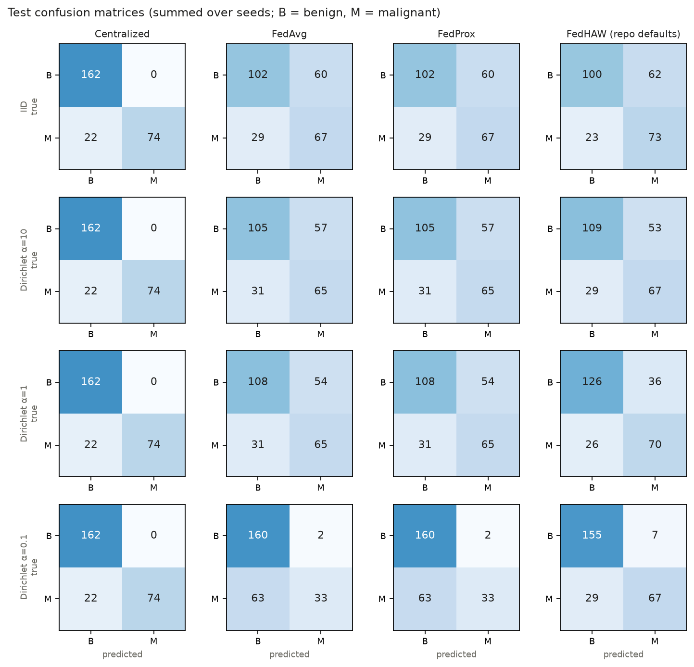
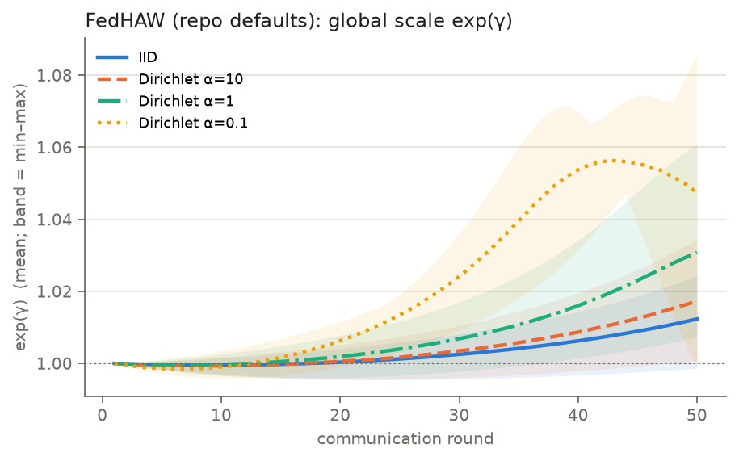
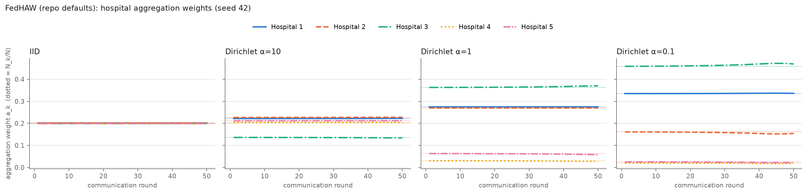
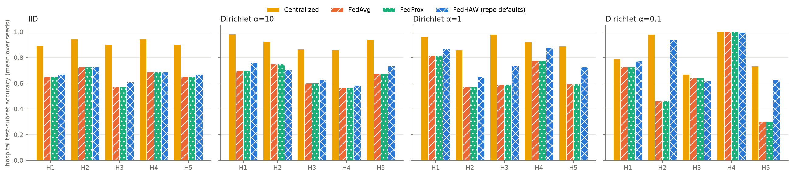
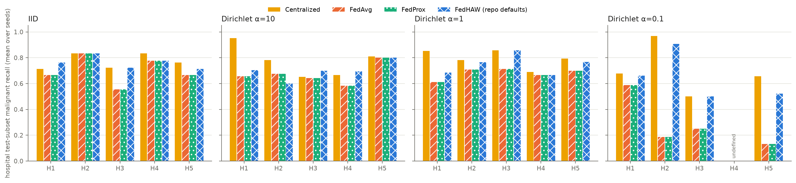
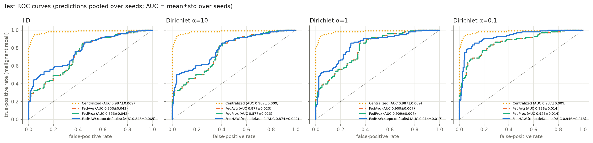
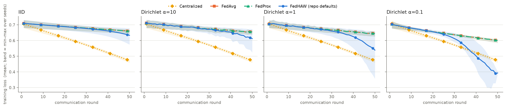
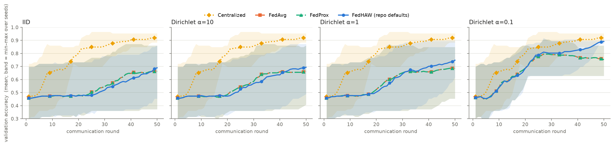
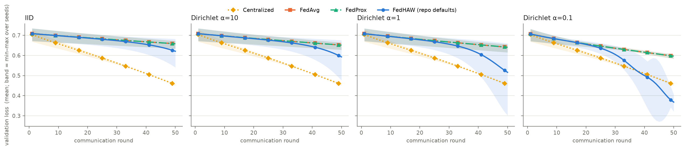
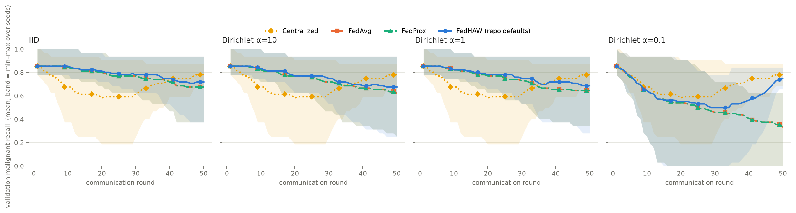
